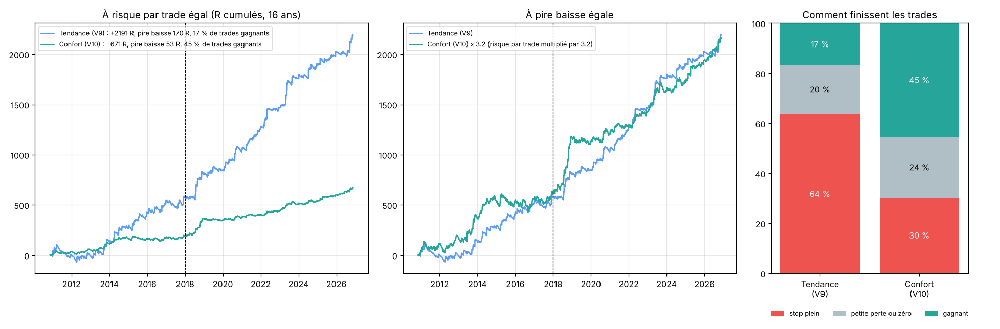

# Rapport — Stratégie Nasdaq (US100 / NQ) — session 4 : cause des stops, taux de réussite, autres marchés

Date : 21 novembre 2026.
Ta demande : « régler les limites, avoir un bon taux de réussite, trouver la cause des stops », et regarder aussi le Dow Jones, le DAX,
l'or, le Bitcoin, l'EUR/USD et le GBP/USD.
Les rapports précédents sont conservés : `rapport-session3.md` (examen sur 2010-2017, Strategy V9) et `rapport-session2.md` (V7, V8).

Trois mots utilisés partout :
- **R** : la somme risquée sur un trade. Si le stop est touché, on perd 1 R. À 0,25 % de risque par trade, 1 R = 0,25 % du compte.
- **Trade gagnant** : un trade qui finit à plus de +0,05 R (les sorties à zéro ne comptent pas comme gagnantes).
- **t** : une note de solidité. Au-dessus de 2, il y a peu de chances que le résultat soit dû au hasard ; en dessous de 1,65, on ne peut rien conclure.

## En bref

1. **La cause des stops est trouvée : le stop est trop court, ce n'est pas le sens qui est mauvais.** Sur 16 ans, après un stop, le Nasdaq
   repart **une fois sur trois** de +2 R ou plus dans le sens du trade qui vient d'être coupé. Il ne va franchement dans le mauvais sens
   qu'une fois sur quatre. Le stop de la V9 (un range de 5 minutes, soit 0,2 à 0,3 % du prix, à l'heure la plus agitée de la journée) se fait
   balayer par le bruit.
2. **Le remède qui marche : un stop 3 fois plus loin avec des lots 3 fois plus petits.** La somme risquée par trade ne change pas.
   C'est le **profil Confort** de la nouvelle **Strategy V10**. Le taux de trades gagnants passe de 18 % à **47 %** (2018-2026) et de 15 % à
   **44 %** (2010-2017). Les stops pleins passent de 63 % à 30 % des trades.
3. **Ce que le Confort ne fait pas : gagner plus.** À pire baisse égale, les deux profils rapportent à peu près la même chose sur 16 ans.
   Le Confort échange de gros gains rares contre des gains moyens fréquents. Ce qu'il apporte vraiment : des séries de pertes 3 fois plus
   courtes, 3 fois moins de lots ouverts, et une stratégie qui ne s'effondre plus quand les coûts sont lourds.
4. **Les autres méthodes pour monter le taux de réussite détruisent le gain.** Un objectif à +1 R donne 52 % de réussite mais un gain total
   proche de zéro. Prendre la moitié à +1 R divise le gain par deux. Seul l'élargissement du stop garde un avantage solide.
5. **Mauvaise nouvelle, nette : rien ne marche sur les six autres marchés.** J'ai écrit le test à l'avance puis appliqué le robot tel quel
   au Dow Jones, au DAX, à l'or, au Bitcoin, à l'EUR/USD et au GBP/USD : aucun n'est gagnant. J'ai ensuite testé six stratégies
   classiques sur bougies longues (repli en tendance, cassure de 20 jours, nuit, range asiatique...) : aucune ne passe le critère écrit avant.
6. **Recommandation.** Strategy V10, profil Confort, **sur le Nasdaq uniquement**, à 0,25 % de risque par trade (le réglage de la V9,
   inchangé), en démo d'abord. Ne copie pas le robot sur les autres marchés.
7. **Ce qui reste non réglé.** Pas de diversification trouvée. Le profil Confort a été mis au point en regardant tout l'historique du
   Nasdaq : il n'a pas de preuve sur des données vierges. Le robot compile sans erreur mais n'a jamais été vu en train de tourner.

*À gauche : gain cumulé en R sur 16 ans, même risque par trade. Au milieu : le Confort grossi 3,2 fois pour avoir la même pire baisse
que la V9 : les deux courbes arrivent au même endroit. À droite : comment finissent les trades.*

## 1. La cause des stops

J'ai repris chaque trade de la V9 terminé au stop (63 à 65 % des trades) et regardé ce qui s'est passé avant et après.
Les chiffres sont presque identiques sur 2018-2026 et sur 2010-2017, ce qui est rassurant : ce n'est pas un accident d'une période.

**Avant le stop**

| Ce qui s'est passé | Part des stops |
|---|---|
| Fausse cassure immédiate : stop touché en 10 minutes ou moins, sans jamais atteindre +0,5 R | 32 % |
| Essoufflement : le prix traîne puis revient | 21 % |
| Bien parti (+0,5 à +1,5 R) puis revenu au stop | 32 à 37 % |
| Pyramide ajoutée à +2 R puis retour | 10 à 13 % |

**Après le stop**

| Ce que fait le marché ensuite | Part des stops |
|---|---|
| Il va à +2 R ou plus **dans le sens du trade** : l'idée était bonne, le stop trop court | **34 %** |
| Il part franchement dans l'autre sens : l'idée était mauvaise | 27 % |
| Pas de direction nette | 39 % |

Autres constats : 47 % des stops tombent avant 10:00 et 72 % avant 10:30. Un jour de trade sur deux, toutes les entrées du jour sont stoppées.

**Peut-on reconnaître ces stops avant l'entrée ?** Non, pas mieux qu'avant. Les sessions précédentes ont testé l'heure, la taille du range,
le gap, la tendance H1 / H4 / jour, le RSI, le MACD, le VWAP, l'Ichimoku, les moyennes mobiles, Fibonacci, la force de la bougie de
cassure, les annonces : seuls les deux filtres déjà dans la V7 (RSI du bon côté de 50, range qui dépasse les 30 minutes précédentes) et
l'exclusion des jours de Fed tiennent sur des données non vues. Cette session j'ai ajouté l'idée « le Dow Jones confirme le Nasdaq » :
aucun effet (t = 0,03 et −0,34). Le schéma des stops n'est donc pas « un mauvais signal qu'on pourrait filtrer » : c'est un stop
placé dans le bruit de l'ouverture.

Détail : `resultats/70_causes_sl.md`, `resultats/76_confirmation_dow.md`.

## 2. Les remèdes essayés

Mêmes signaux, seule la gestion change. Nasdaq, 2018-2026 puis 2010-2017.

| Remède | Taux de réussite | Effet sur le gain total | Verdict |
|---|---|---|---|
| Objectif fixe à +1 R | 52 % | tombe à environ zéro | rejeté |
| Objectif fixe à +2 R | 36 % | divisé par 5 | rejeté |
| Sortir la moitié à +1 R | 36 % | divisé par 2 | rejeté |
| Stop ramené à l'entrée dès +1 R | un peu plus haut | baisse | rejeté |
| Entrer après la clôture de la bougie de 5 minutes | — | baisse | rejeté |
| Sortie à 12:00 ; supprimer la pyramide | — | baisse | rejeté |
| Sortie à 10:30 | — | neutre | sans intérêt |
| **Stop élargi 3 fois, lots divisés par 3** | **47 à 51 %** | divisé par 3,4 en R, **inchangé à baisse égale** | **retenu** |

**Pourquoi 3 ?** J'ai essayé toutes les largeurs de 1 à 8. Entre 2,5 et 4, les résultats se valent (un plateau, pas un pic isolé), sur les deux
périodes et aux deux niveaux de coût. 3 est le milieu du plateau. Détail : `resultats/71_remedes.md`, `resultats/72_largeur_stop.md`.

## 3. Le profil Confort (Strategy V10)

**Les règles.** Tout est comme la V9 (cassure A, repli VWAP B, continuations D1 à D3, entrée de 10:00 coupée), avec quatre différences :
- le stop est 3 fois plus loin : pour un achat, 3 ranges sous le niveau de cassure au lieu de 1 ;
- les lots sont 3 fois plus petits : la somme risquée reste la même ;
- la règle de mémoire devient : après un trade de cassure qui finit à plus de +1 R, le signal suivant est sauté ;
- les continuations ne sont armées que si l'autre bord du range n'a pas été touché depuis la cassure.

Le stop ramené à l'entrée (+1,5 R) et la pyramide (+2 R) existent toujours, mais comptés avec ce R trois fois plus grand : ils se
déclenchent donc plus rarement.

**Les deux profils côte à côte** (total de toutes les entrées, en R)

| Nasdaq | Tendance (V9) | Confort (V10) |
|---|---|---|
| **2018-2026**, spread réel + 1 point de glissement | +1 614 R | +477 R |
| · trades gagnants / stops pleins | 18 % / 63 % | **47 % / 30 %** |
| · pire baisse | 56 R | 32 R |
| · solidité (t) ; années positives | 4,7 ; 9 sur 9 | 4,2 ; 8 sur 9 (2019 : −12 R) |
| · avec 3 points de glissement | +799 R, pire baisse 157 R | +301 R, pire baisse 70 R |
| **2010-2017**, coûts au poids d'aujourd'hui | +577 R | +194 R |
| · trades gagnants | 15 % | **44 %** |
| · pire baisse | 170 R | 53 R |
| · solidité (t) ; années positives | 2,2 ; 6 sur 8 | 2,1 ; **8 sur 8** |
| · avec les coûts au poids de 2018 | **−157 R** | +23 R |
| · 2013-2017 avec les vrais spreads Dukascopy de l'époque | **−66 R** | +1 R |
| Plus longue série de jours perdants | 24 à 33 jours | 8 à 14 jours |
| Lots ouverts en même temps, au maximum | 15 | 5 |
| Pire journée | −5,4 R | −5,1 R |
| Plus longue attente d'un nouveau plus haut | 8 mois (2018-2026), 31 mois (2010-2017) | **20 mois** (2018-2026), **32 mois** (2010-2017) |

**Année par année (R)**

| | 2010 | 2011 | 2012 | 2013 | 2014 | 2015 | 2016 | 2017 | 2018 | 2019 | 2020 | 2021 | 2022 | 2023 | 2024 | 2025 | 2026 |
|---|---|---|---|---|---|---|---|---|---|---|---|---|---|---|---|---|---|
| V9 | −10 | 14 | −6 | 139 | 130 | 166 | 113 | 30 | 226 | 43 | 181 | 236 | 209 | 290 | 130 | 136 | 164 |
| Confort | 2 | 34 | 20 | 59 | 50 | 6 | 9 | 15 | 168 | −12 | 23 | 27 | 45 | 61 | 32 | 63 | 70 |

**Comment lire tout cela, honnêtement**
- **À pire baisse égale, c'est le même gain.** Sur 16 ans : V9 +2 191 R pour une pire baisse de 170 R ; Confort +671 R pour 53 R. Le rapport
  est le même (environ 13). Si tu montais le risque du Confort jusqu'à avoir la même pire baisse que la V9, tu gagnerais autant, pas plus.
- **Le Confort gagne plus souvent, pas plus.** Un trade gagnant du Confort rapporte en moyenne bien moins qu'un gagnant de la V9.
- **Le vrai progrès est la résistance aux coûts.** Là où la V9 perd (coûts lourds de 2010-2017), le Confort reste à zéro ou un peu au-dessus.
  Avec 3 points de glissement il garde 63 % de son gain, la V9 50 %.
- **Le point faible du Confort : les plateaux.** Les baisses sont moins profondes mais le capital peut stagner longtemps : 20 mois entre
  fin 2018 et août 2020, 32 mois entre 2015 et 2017. Et 2018 pèse lourd : 168 R sur 477, soit 35 % du gain de 2018-2026.
- **Réserve importante.** La largeur 3 a été choisie après avoir vu tout l'historique du Nasdaq, parmi 67 variantes. Ce qui la soutient :
  un plateau large, présent sur les deux périodes, et une explication simple. Ce qui lui manque : une preuve sur des données jamais vues.
  Le test sur les six autres marchés devait la fournir ; il a échoué (section 4).

**En pourcentage du compte** (addition simple des R, sans intérêts composés ; simulation de 10 000 années à partir des trades)

| Sur un an | Confort à 0,25 % (réglage livré) | Confort à 0,5 % | Tendance (V9) à 0,25 % |
|---|---|---|---|
| Année médiane si l'avenir ressemble à 2018-2026 | environ +13 % | environ +26 % | environ +43 % |
| Année médiane si l'avenir ressemble à 2010-2017 | environ +7 % | environ +14 % | environ +19 % |
| Part d'années négatives (scénario 2010-2017) | 23 % | 23 % | 21 % |
| Baisse habituelle dans l'année (favorable / prudent) | 4,5 % / 6,5 % | 9 % / 13 % | 10,5 % / 15,5 % |
| Baisse une année sur vingt (favorable / prudent) | 9 % / 13 % | 17,5 % / 26 % | 19,5 % / 30 % |
| Pire journée des tests | −1,3 % | −2,6 % | −1,4 % |
| Pire baisse sur 16 ans | 13 % | 26,5 % | 42,5 % |

Le fichier livré est réglé sur **0,25 % par trade, comme la V9**. 0,5 % était ton réglage des V6 à V8 ; y revenir double les gains et les
baisses de la première colonne. C'est ta décision, pas la mienne. Je te conseille de la prendre après la démo, quand tu connaîtras
ton glissement réel. Aucun de ces chiffres n'est une promesse : ce sont des simulations.

Détail : `resultats/80_confort_final.md`, `resultats/73_profils.md`, listes de trades `resultats/trades_V10_confort_*.csv`.

## 4. Les six autres marchés : le test écrit à l'avance

**La question.** L'avantage « cassure de l'ouverture dans le sens de l'élan » existe-t-il ailleurs que sur le Nasdaq ?
**La méthode.** Avant de regarder un seul résultat, j'ai écrit dans le journal : l'heure d'ouverture de chaque marché, les coûts,
les trois profils jugés, la règle de lecture. Aucun réglage n'a été adapté. Données Dukascopy à la minute (prix acheteur et vendeur),
de 2013 à fin 2023. Les années 2024-2026 de ces marchés ont été mises de côté et n'ont jamais été regardées.

| Marché (ouverture testée) | Coût d'un aller-retour, en part du range | Tendance (V9) | Confort | Confort + objectif +1 R | Verdict |
|---|---|---|---|---|---|
| *Nasdaq 2018-2026, pour mémoire* | *3 % aujourd'hui (16 % en 2018)* | *+1 614 R* | *+477 R* | *+240 R* | *gagnant* |
| Dow Jones (9:30 New York) | 10 % | −38 R | −26 R | +11 R | rien |
| DAX (9:00 Francfort) | 9 % | −16 R | +19 R | −21 R | rien |
| Or (8:20 New York) | 24 % | −287 R | −60 R | −95 R | perdant |
| EUR/USD (8:00 Londres) | 17 % | −771 R | −170 R | −106 R | perdant |
| GBP/USD (8:00 Londres) | 21 % | −760 R | −246 R | −188 R | perdant |
| Bitcoin (9:30 New York) | 95 % | −3 468 R | −1 165 R | −1 218 R | intradable en 5 minutes |

**Pourquoi.** Deux raisons, qui s'ajoutent :
1. **Le coût.** Sur l'or, les devises et le Bitcoin, le range de 5 minutes est si petit que le spread et le glissement en mangent 17 à 95 %.
   Sur le Bitcoin, le spread de Dukascopy fait 50 à 120 dollars.
2. **L'élan n'existe pas.** Sur le Dow et le DAX le coût est supportable (9 à 10 %), mais la cassure seule ne gagne rien (t = 0,4 et −0,4).
   L'effet « l'ouverture donne le ton de la journée » est une particularité du Nasdaq (et un peu du S&P 500, vu en session 3).

J'ai aussi regardé, pour information, d'autres heures d'ouverture (DAX à 9:30 New York, or à Londres et à 9:30, devises à 8:00 New York,
Bitcoin à minuit UTC). Seul « DAX à l'ouverture de New York » est positif (t = 1,6), ce qui n'est pas assez pour conclure, d'autant
que c'est une séance sur les 12 testées.

**Conséquence.** Ne copie pas le robot sur ces marchés. Et le profil Confort n'a pas reçu la preuve indépendante que j'espérais.

Détail : `resultats/75_multi_marches_principal_2023-12-31.md`, `resultats/75_multi_marches_secondaire_2023-12-31.md`, `resultats/74_qualite_marches.md`.

## 5. Six stratégies classiques sur bougies longues

Puisque les coûts tuent le très court terme sur ces marchés, j'ai testé des idées à horizon plus long (bougies d'une heure et d'un jour),
où le coût pèse peu. Pour chacune, l'idée et les paramètres « de manuel » ont été écrits avant, sans aucune optimisation, avec spread réel,
glissement et frais de portage de nuit. Critère écrit avant : au moins 60 trades, t d'au moins 2, au moins 60 % d'années positives.

| Stratégie | Ce qui s'en approche le plus | Le reste | Verdict |
|---|---|---|---|
| Repli en tendance, bougies jour (acheter une forte baisse de 2 jours au-dessus de la moyenne 200 jours) | Nasdaq : 68 % de réussite, +0,09 R par trade (t = 1,6). Dow : 76 %, +0,08 R (t = 1,6) | DAX, or, devises, Bitcoin : nul ou négatif | non prouvé |
| Cassure du plus haut de 20 jours | Bitcoin : +1,9 R par trade mais 47 trades seulement (t = 1,5), et tout le gain vient des 23 achats. Nasdaq, Dow : +0,3 R (t = 1,1 à 1,4) | DAX, or, devises : négatif | non prouvé |
| Garder les indices la nuit | +2 à +4 centièmes de pour cent par nuit avant frais | négatif après le portage du CFD | rejeté |
| Repli en tendance, bougies d'une heure | — | négatif sur les 7 marchés | rejeté |
| Cassure du plus haut de 55 heures | indices : +0,1 R (t < 1,4) | devises, Bitcoin : négatif | rejeté |
| Cassure du range de la nuit asiatique à l'ouverture de Londres | — | EUR/USD, GBP/USD, or : négatif ou nul | rejeté |

**Aucun couple (stratégie, marché) sur 44 ne passe le critère.** Les années 2024-2026 de ces marchés n'ont donc pas été ouvertes : elles
restent disponibles pour juger une idée future.

Une remarque pour ta recherche d'un bon taux de réussite : le repli en tendance sur le Nasdaq et le Dow gagne 68 à 76 % du temps, mais
chaque gain est si petit (moins de 0,1 R) et les trades si rares (9 par an) que je ne peux pas distinguer cet avantage du hasard.
Un taux de réussite élevé ne dit rien du gain.

Détail : `resultats/78_tournoi_2023-12-31.md`, `resultats/79_range_asiatique_2023-12-31.md`, idées écrites avant : `notes/idees-strategies.md`.

## 6. Les sept limites du diagnostic : où on en est

| Limite | État après cette session |
|---|---|
| 1. La stratégie dépend des coûts | **Réduite, pas supprimée.** Le Confort reste à zéro ou au-dessus là où la V9 perd. Le garde-fou coût est toujours dans le robot. |
| 2. Elle n'est pas prouvée en dehors de 2018-2026 | **En partie.** Le Confort est positif 8 années sur 8 sur 2010-2017 aux coûts d'aujourd'hui (t = 2,1), mais il a été conçu après avoir vu ces années. |
| 3. Profil « loterie » (18 % de gagnants, longues séries de pertes) | **Réglée, avec une contrepartie.** 44 à 47 % de trades gagnants, séries de 8 à 14 jours perdants au lieu de 24 à 33. Contrepartie : des plateaux plus longs. |
| 4. Pas de diversification | **Non réglée.** Rien ne gagne sur les six autres marchés, ni le robot transposé, ni six stratégies classiques. |
| 5. Pas d'interrupteur | **Réglée sur le papier.** Des seuils d'alerte chiffrés (section 7). Ils ne sont pas codés dans le robot : c'est à toi de les suivre. |
| 6. Biais de sélection (beaucoup d'essais) | **Toujours là.** Environ 2 000 essais depuis le début, dont 240 cette session. Le Confort est un choix fait après coup. |
| 7. Le robot n'a jamais été exécuté | **Toujours là.** Il compile sans erreur ; le testeur de MetaTrader et le backtest TradingView demandent ton compte. |

## 7. L'interrupteur : quand s'inquiéter

Avec 18 % de trades gagnants, il fallait des années pour savoir si la V9 marchait encore. Avec le Confort, on le voit plus vite.
Le robot trade environ un jour sur deux (105 à 125 jours par an). Voici ce que les tests donnent sur **60 jours de trade** (environ 6 mois) :

| Sur 60 jours de trade (profil Confort) | Normal | Pire passage des 16 ans | Seuil d'alerte (arrive moins d'une fois sur 100 si la stratégie marche) |
|---|---|---|---|
| Part de jours gagnants | 43 % | 28 % | **moins de 28 %** (16 jours gagnants ou moins sur 60) |
| Résultat total | +9 à +19 R | −33 R | **pire que −40 R** |
| Baisse depuis le dernier plus haut | 18 à 26 R dans une année normale | 53 R | **plus de 66 R** |

Règle simple : si un seul de ces trois seuils est franchi, coupe le robot et fais le point (coûts réels, glissement, changement de courtier,
changement de comportement du marché) avant de le relancer. En démo, compare aussi chaque trade au backtest : même heure, même sens, même prix à
quelques points près. Détail : `resultats/83_surveillance.md`.

## 8. Recommandation

1. **Installe Strategy V10 sur le Nasdaq, profil Confort, en démo.** Réglages par défaut : largeur du stop 3, risque 0,25 % par trade.
   Notice : `strategies/LISEZMOI.md`.
2. **N'installe pas le robot sur le Dow, le DAX, l'or, le Bitcoin, l'EUR/USD ou le GBP/USD.** Sur ces marchés, je n'ai aucune stratégie à te proposer.
3. **Ne fais pas tourner la V9 et la V10 en même temps sur le même compte** : elles utilisent les mêmes numéros d'identification d'ordres.
4. **Si tu préfères le maximum de gain et que tu supportes 18 % de trades gagnants**, le profil Tendance est dans le même fichier :
   largeur du stop 1 et « gagnant au-delà de » 0,05. C'est exactement la V9.
5. **Ne règle plus rien sur le Nasdaq à partir du backtest.** Toutes les données de 2010 à 2026 ont été vues ; tout nouveau réglage serait
   de l'ajustement sur le passé.

## 9. Risques

- **Aucun gain n'est garanti.** Le scénario prudent (2010-2017) compte une année négative sur quatre ou cinq.
- **Le glissement réel décide de tout.** Les ordres sont des ordres stop exécutés dans les minutes les plus agitées de la journée.
  Mes tests supposent 1 point ; à 3 points le gain du Confort baisse de 37 % et sa pire baisse double.
- **Le Confort n'a pas de preuve indépendante.** Il peut décevoir par rapport au tableau de la section 3.
- **Une seule source de gain, un seul marché.** Si l'élan de l'ouverture du Nasdaq disparaît, tout disparaît en même temps.
- **Des stops plus loin veulent dire des positions tenues plus longtemps** dans la journée ; toutes sont fermées à 15:50, aucune la nuit.
- **Le code n'a pas été vu en exécution.** Une erreur de comportement reste possible malgré la compilation sans erreur.

## 10. Prochaines étapes

1. Passer le robot dans le testeur de stratégie de MetaTrader 5 sur les 12 derniers mois (mode « ticks réels ») et m'envoyer le rapport :
   je le comparerai trade par trade à ma simulation.
2. Le laisser tourner en démo et noter, pour chaque ordre, l'écart entre le prix demandé et le prix obtenu (le glissement).
3. Suivre les trois seuils de la section 7.
4. Décider du risque par trade (0,25 % ou plus) une fois le glissement réel connu.
5. Si tu veux poursuivre sur les autres marchés : choisir **une** idée, l'écrire à l'avance, la mettre au point sur les données jusqu'à 2023,
   et la juger une seule fois sur 2024-2026. Les deux pistes les moins mauvaises sont le repli en tendance sur un panier d'indices
   américains et le suivi de tendance long à l'achat sur le Bitcoin ; aucune n'est prouvée.

## Ce que contient le dossier

| Quoi | Où |
|---|---|
| Le robot MetaTrader 5 (source et compilé) et le script TradingView | `strategies/Strategy-V10.mq5`, `.ex5`, `.pine` |
| La notice d'installation | `strategies/LISEZMOI.md` |
| Les versions précédentes (V9, V8, V7) | `strategies/` |
| Les résultats de cette session | `resultats/70` à `83`, `registre_session4.md` |
| Le journal complet et les idées écrites avant les tests | `notes/nasdaq-progress.md`, `notes/idees-strategies.md` |
| Le code des tests | `scripts/` (68 à 83 pour cette session) |
